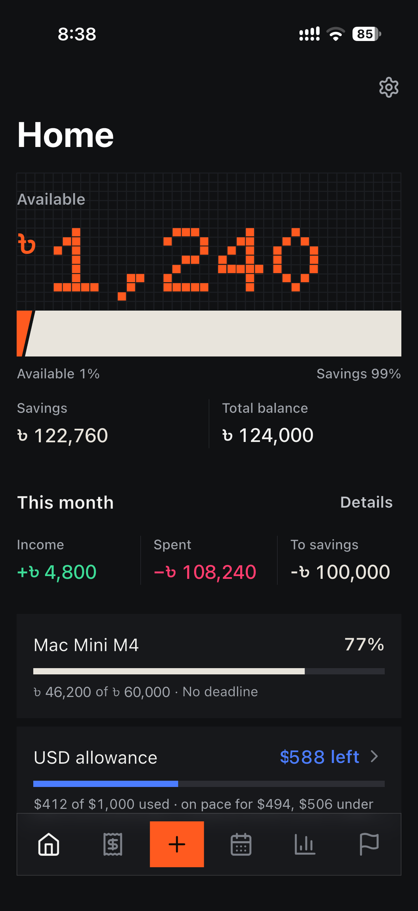
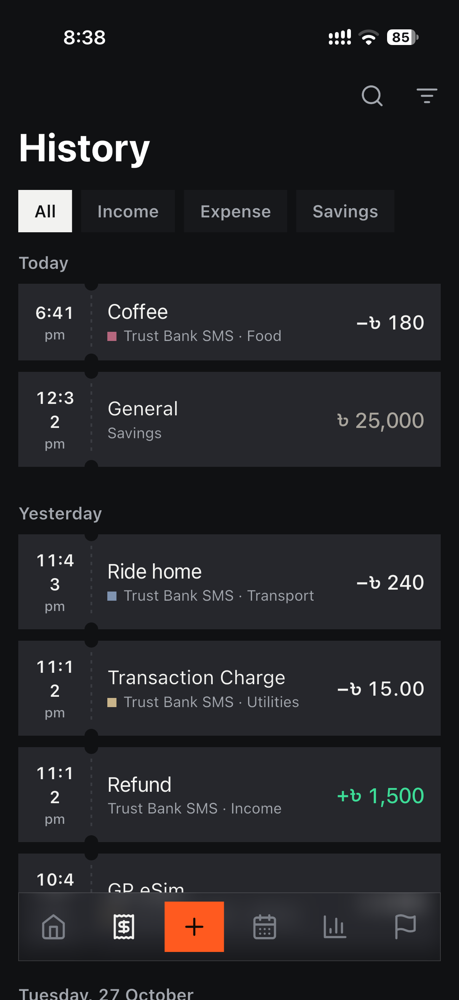
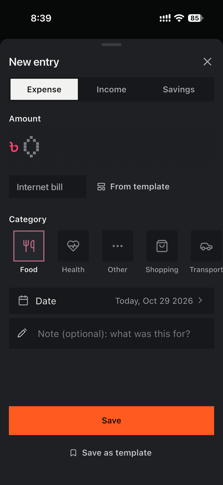
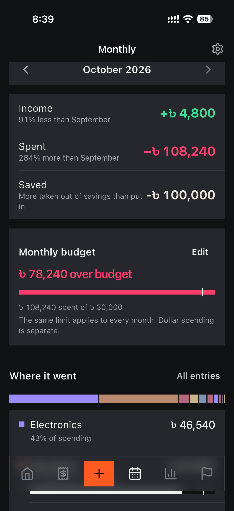
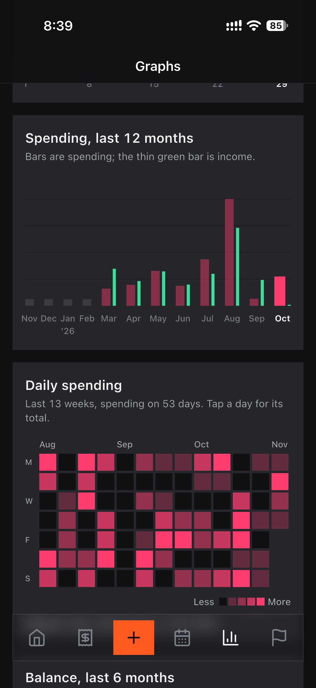
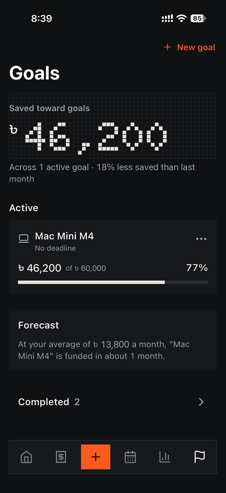
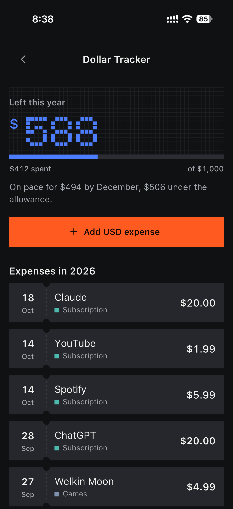
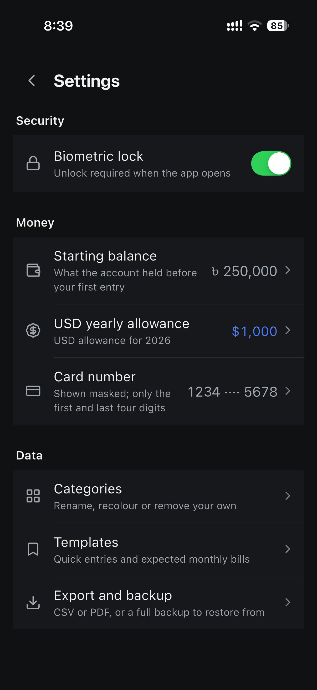
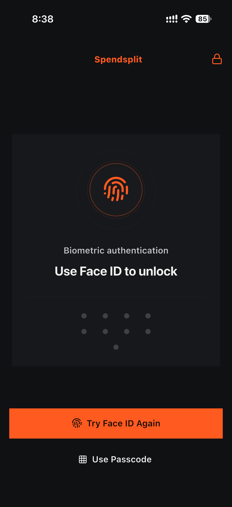

# SpendSplit

A minimalist, **offline-only** expense tracker for iOS and Android, built with Flutter.
It splits one bank-account balance into **Available** (spendable) and **Savings**, with
a biometric lock and a separate USD spending tracker.

> No cloud, no accounts, no sync. All data lives on the device (SQLite), and sensitive
> settings are kept in the platform keystore. The home-screen widget is Android-only
> for now.

---

## Screens

| Home | History | New entry |
|---|---|---|
|  |  |  |

| Monthly | Graphs | Goals |
|---|---|---|
|  |  |  |

| Dollar Tracker | Settings | Lock |
|---|---|---|
|  |  |  |

<sub>All figures, names and the card number in the screenshots are dummy data.</sub>

---

## Features

- **Split balance**: one bank balance, tracked as Available + Savings. Every figure
  (Total, Available, Savings, Dollar Remaining) is derived from the entries, never stored.
- **Home**: the Available hero figure with a split bar against Savings, this month's
  income / spending / savings, the top goal and the USD allowance.
- **History**: entries as ticket-style coupons grouped by day, with search and
  income / expense / savings filters. Future-dated entries show dashed and stay out
  of balances until their date.
- **Monthly**: income, spending and savings against last month, a monthly budget with a
  pace marker, and a per-category breakdown with optional category budgets.
- **Graphs**: this month's running spend against last month, 12-month spending with an
  income overlay, a 13-week daily-spending heatmap and a 6-month balance trend.
- **Savings goals**: contributions post a linked savings deposit; each goal shows its
  history and a completion forecast from your saving pace.
- **Templates**: save any entry as a template. The three most used appear as quick
  chips, and templates marked *Expected monthly* that haven't been logged yet show on Home.
- **Dollar Tracker**: a fully separate USD ledger with an annual allowance and a
  year-end pace projection. No currency conversion and no effect on BDT figures.
- **Month-end recap**: a dismissible Home card (days 1 to 5) summarising last month.
- **Categories**: six locked defaults plus your own, which you can rename, re-icon and recolour.
- **Backup**: CSV / PDF export, CSV import, and a full JSON backup with a
  hold-to-confirm restore.
- **Trust Bank SMS import**: debit and credit alerts become entries flagged for review,
  with a bank-balance check on Home.
  - Android reads the SMS directly, on open and in the background.
  - iOS has no SMS access, so a Shortcuts automation saves each alert into the app's
    `SMS Inbox` folder, and the app imports it the next time it opens.
- **Privacy**: biometric lock (Face ID / fingerprint), and balances are hidden in the
  app switcher.

---

## Install

Download the latest build from [Releases](https://github.com/Abrar118/spendsplit/releases).

- **Android**: install the `.apk` (allow installs from unknown sources).
- **iOS**: the `.ipa` is unsigned. Sideload it with a tool that signs it with your own
  Apple ID, such as [AltStore](https://altstore.io) or
  [Sideloadly](https://sideloadly.io). With a free Apple ID the app has to be
  re-signed every 7 days. Or build from source (below).

---

## Tech stack

| Concern | Choice |
|---|---|
| State | Riverpod |
| Database | Drift (SQLite), schema v8, additive migrations |
| Navigation | GoRouter (ShellRoute + pushed routes) |
| Charts | fl_chart |
| Typography | Platform sans (SF Pro / Roboto) with tabular figures; Doto dot-grid numerals for hero figures |
| Auth | local_auth |
| Secure storage | flutter_secure_storage |
| Files | file_selector, share_plus, path_provider, pdf |
| Widget | home_widget (Android) |
| Design | "Grid Numerals": near-black ground, square modules, one colour per meaning (see `DESIGN.md`) |

Architecture is feature-first MVVM: pure-Dart calculators (unit-tested), exposed
through Riverpod providers and consumed by thin widgets.

```
lib/
├── core/        theme, constants, utils, shared widgets
├── data/        database (tables, daos), models, repositories
├── features/    auth · dashboard · transactions · monthly · graphs · goals · dollar_tracker · export · settings · sms_import · widget
└── providers/   global Riverpod providers
```

---

## Build & run

```bash
flutter pub get
dart run build_runner build --delete-conflicting-outputs   # Drift codegen
flutter run
```

Tests: `flutter test` covers calculator regressions, schema migrations, the backup
round trip, SMS parsing and import, graph series maths, and widget layout guards.

iOS builds need macOS with Xcode. To update an installed app without losing its data,
install over it (`flutter run --release` or `xcrun devicectl device install app`).
Don't uninstall first.
